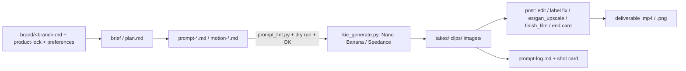

# Repo map

Generated by `python3 scripts/repo_map.py`. Read this to find files instead of searching. Media is counted, not listed (use `ls` on the folder).

## (root)
- `CLAUDE.md`: AI Ads Workspace
- `README.md`: AI Ads
- `REPO_MAP.md`: Repo map
- `SETUP.md`: Setup for a new chat, account or container
- `STATUS.md`: Status (updated 12 Nov 2026)

## ads
- `_shot-template.md`: Shot <nn>: <slug>

## ads/jpg-spec/ultra-male-12s
- `edit_ultra_male.py`: Ultra Male spec edit, frame-exact, from the take and its inserts (Narayan, 4-5 Nov).
- `plan.md`: Jean Paul Gaultier Ultra Male — 12 s portfolio spec ad (ad 3)
- `prompt-lavender-4s.md`: Image 1 is Jean Paul Gaultier's official product photo of the real Ultra Male eau de toilette bottle, front vi
- `prompt-seedance-12s.md`: Image 1 is Jean Paul Gaultier's official product photo of the real Ultra Male eau de toilette bottle, front vi
- `prompt-storm-4s.md`: Image 1 is Jean Paul Gaultier's official product photo of the real Ultra Male eau de toilette bottle, front vi
- media: 2 .mp4

## ads/jpg-spec/ultra-male-12s/refs
- media: 1 .jpg

## ads/jpg-spec/ultra-male-12s/takes
- media: 9 .mp4

## ads/misfits
- `higgsfield-batch.md`: Higgsfield Ultra batch (bought 14 Nov 2026, sale price $79)
- `prompt-log.md`: Misfits prompt log (own demos and spec work)

## ads/misfits/clients/avrana
- `deploy_site.py`: Deploy the Avrana pitch site folder to https://misfits-avrana.vercel.app (Vercel token injected by the session proxy;
- `fetch_images.py`: Download every product image from avrana.co (Shopify products.json) into product-images/<product>/NN.jpg at
- `call-prep.md`: Avrana — call prep (Jose, Discord, Wed 11 Nov 2026, 11:00 AM CST = 10:30 PM IST)
- `deliverables-15-day.md`: Avrana × Misfits: 15-day Content Engine (trial)
- `prompt-log.md`: Avrana prompt log
- media: 1 .jpg

## ads/misfits/clients/avrana/demo-death-glory
- `deflicker_subject.py`: Take the glow flashes off the print in a Seedance take, shot by shot.
- `finish_film.py`: Finish the Death & Glory demo film for Avrana: a 1080x1920 master with an end card.
- `patch_frames.py`: Replace frames of a video with copies of other frames (same length, audio untouched).
- `recut_macros.py`: Recut the Death & Glory film with more macro shots, at no generation cost.
- `prompt-seedance-12s-v2.md`: Image 1 is Avrana's official product photo of the black Death & Glory hoodie from the back. Use Image 1 only f
- `prompt-seedance-12s-v3.md`: Image 1 is Avrana's official product photo of the black Death & Glory hoodie from the back. Use Image 1 only f
- `prompt-seedance-12s-v4.md`: Image 1 is Avrana's official product photo of the black Death & Glory hoodie from the back. Use Image 1 only f
- `prompt-seedance-12s-v5.md`: Image 1 is Avrana's official product photo of the black Death & Glory hoodie from the back. Use Image 1 only f
- `prompt-seedance-12s-v6.md`: Image 1 is Avrana's official product photo of the black Death & Glory hoodie from the back. Image 2 is Avrana'
- `prompt-seedance-12s.md`: Image 1 is Avrana's official product photo of the black Death & Glory hoodie from the back. Use Image 1 only f
- `prompt-seedance-4s-front-test.md`: Image 1 is Avrana's official product photo of the black Death & Glory hoodie from the back. Image 2 is Avrana'
- `prompt-seedance-4s-test.md`: Image 1 is Avrana's official product photo of the black Death & Glory hoodie from the back. Use Image 1 only f
- `prompt-seedance-6s-macros.md`: Image 1 is Avrana's official product photo of the black Death & Glory hoodie from the back. Image 2 is Avrana'
- media: 3 .mp4

## ads/misfits/clients/avrana/demo-death-glory/takes
- media: 3 .mp4

## ads/misfits/clients/avrana/demo-game-cutscene
- `prompt-seedance-18s-fighter.md`: Image 1 is Avrana's official product photo of the black Death & Glory hoodie from the back. Image 2 is Avrana'
- `prompt-seedance-18s.md`: Image 1 is Avrana's official product photo of the black Death & Glory hoodie from the back. Image 2 is Avrana'

## ads/misfits/clients/avrana/product-images
- media: 1 .png

## ads/misfits/clients/avrana/product-images/apex
- media: 13 .jpg

## ads/misfits/clients/avrana/product-images/apex-long-sleeve
- media: 8 .jpg

## ads/misfits/clients/avrana/product-images/apex-t-shirt
- media: 7 .jpg

## ads/misfits/clients/avrana/product-images/death-amp-glory
- media: 10 .jpg

## ads/misfits/clients/avrana/product-images/death-amp-glory-hoodie
- media: 10 .jpg

## ads/misfits/clients/avrana/product-images/death-amp-glory-long-sleeve
- media: 8 .jpg

## ads/misfits/clients/avrana/product-images/eternal-grace
- media: 6 .jpg

## ads/misfits/clients/avrana/product-images/eternal-grace-hoodie
- media: 10 .jpg

## ads/misfits/clients/avrana/product-images/eternal-grace-t-shirt
- media: 7 .jpg

## ads/misfits/clients/avrana/product-images/hoodie-blank
- media: 10 .jpg

## ads/misfits/clients/avrana/product-images/house-of-grace
- media: 14 .jpg

## ads/misfits/clients/avrana/product-images/house-of-grace-long-sleeve
- media: 8 .jpg

## ads/misfits/clients/avrana/product-images/house-of-grace-t-shirt
- media: 7 .jpg

## ads/misfits/clients/avrana/product-images/instinct
- media: 6 .jpg

## ads/misfits/clients/avrana/product-images/instinct-hoodie
- media: 9 .jpg

## ads/misfits/clients/avrana/product-images/instinct-t-shirt
- media: 7 .jpg

## ads/misfits/clients/avrana/product-images/screens
- media: 2 .png

## ads/misfits/clients/avrana/product-images/sweatshirt-blank
- media: 5 .jpg

## ads/misfits/clients/avrana/product-images/t-shirt-blank
- media: 16 .jpg

## ads/misfits/clients/avrana/product-images/untamed
- media: 9 .jpg

## ads/misfits/clients/avrana/product-images/untamed-hoodie
- media: 10 .jpg

## ads/misfits/clients/avrana/product-images/untamed-long-sleeve
- media: 5 .jpg

## ads/misfits/faq-album
- `render_faq.js`: Render faq.html slides to slide-1.png ... slide-5.png (1080x1350). Usage: node render_faq.js
- `post.md`: Misfits — FAQ album (5 photos, 1080×1350)
- media: 5 .png

## ads/misfits/jewellery-demo
- `finish_film.py`: Finish the jewellery demo film for showing to shop owners: 1080x1920 with a sound bed and an end card.
- `make_showcase.py`: Showcase reel for Misfits: the one product photo we were given, then the ad we made from it, then a Misfits card.
- `captions.md`: Jewellery demo: reel captions
- `prompt-seedance-12s.md`: Image 1 is the product photo of the necklace, worn on a linen display bust. Image 2 is a close detail of the f
- `prompt-seedance-4s-test.md`: Image 1 is the product photo of the necklace, worn on a linen display bust. Image 2 is a close detail of the f
- media: 4 .mp4; deliverables: `misfits-jewellery-demo-4k.mp4`, `misfits-jewellery-demo.mp4`, `misfits-jewellery-showcase-4k.mp4`, `misfits-jewellery-showcase.mp4`

## ads/misfits/jewellery-demo/refs
- media: 2 .jpg

## ads/misfits/jewellery-demo/takes
- media: 2 .mp4

## ads/misfits/last-one-reel
- `post.py`: Post for "The last one doesn't fit": sound design + text overlays + final encode.
- `scene.py`: Misfits reel #2, "The last one doesn't fit" — Blender scene, built and rendered from this script.
- media: 1 .wav

## ads/misfits/last-one-reel/overlays
- `make.js`: 
- media: 2 .png

## ads/misfits/launch-reel
- `mix.py`: Sound design + voiceover mix for the Misfits launch reel (all generated here, no licensed audio).
- `render.js`: Render scene.html frame by frame (deterministic, no dropped frames) and pipe to ffmpeg.
- `vo.py`: Misfits launch reel voiceover with Kokoro (free, open-source, runs locally).
- `post.md`: Misfits — first post: launch reel
- media: 1 .jpg, 1 .mp4, 1 .wav; deliverables: `misfits-launch-reel.mp4`

## ads/misfits/launch-reel/breakdown
- `render_breakdown.js`: Render breakdown.html slides to slide-1.png ... slide-5.png (1080x1350). Usage: node render_breakdown.js
- media: 5 .png

## ads/misfits/launch-reel/breakdown/frames
- media: 6 .jpg

## ads/misfits/launch-reel/carousel
- `render_carousel.js`: Render carousel.html slides to slide-1.png ... slide-5.png (1080x1350). Usage: node render_carousel.js
- media: 5 .png

## ads/misfits/launch-reel/carousel/bg
- media: 5 .jpg

## ads/misfits/launch-reel/vo
- media: 7 .wav

## ads/misfits/outreach
- `build_board.py`: Build data/board.json: every pitchable brand from the cache, with contacts, signals and ready messages, for the
- `leads.py`: Misfits lead engine: find Indian D2C brands that are running Meta ads right now, enrich them with their public
- `shopify_leads.py`: Small-brand leads from a public Shopify store list (growthenginenowoslawski/shopify-master-list on GitHub, a
- `update_site.py`: Build site/dist/index.html from the site/index.html template + data/board.json (keeps each lead's first-seen date for the New tag).
- `webcontacts.py`: Free contact enrichment: read each brand's own website (home, contact page, Shopify contact-information policy)
- `README.md`: Misfits outreach engine

## ads/misfits/outreach/site
- `robots.txt`: User-agent: *

## ads/misfits/outreach/site/api
- `state.js`: Shared state for the Misfits lead board (Vercel serverless function, no dependencies).

## ads/misfits/ugc-demos
- `01-coldbrew-seedance.md`: Reference Image1 for the character only: her face, hair, clothes and the car she sits in. Reference Image2 for
- `01-coldbrew-still-creator.md`: A candid vertical iPhone front-camera selfie frame of a 26-year-old Indian woman sitting in the driver's seat 
- `01-coldbrew-still-product.md`: A product photo of a slim 250 ml aluminium can of cold brew coffee standing on a light concrete surface in sof
- `02-gel-seedance.md`: Reference Image1 for the character only: his face, hair, clothes and the bathroom. Reference Image2 for the pr
- `02-gel-still-creator.md`: A candid vertical iPhone front-camera selfie frame of a 24-year-old Indian man standing in a small, bright hom
- `02-gel-still-product.md`: A product photo of a 50 ml frosted glass pump bottle of face gel moisturiser on a white bathroom shelf in soft
- `03-grip-seedance.md`: Reference Image1 for the character only: her face, hair, glasses, clothes and the desk setting. Reference Imag
- `03-grip-still-creator.md`: A candid vertical iPhone front-camera selfie frame of a 28-year-old Indian woman at a home work desk in the af
- `03-grip-still-product.md`: A product photo of a thin circular magnetic phone grip, about the size of a coin stack, lying on a light woode
- `plan.md`: Misfits: 3 talking-head UGC demo ads (portfolio, invented products)

## ads/redbull-spec/cinematic-12s
- `clean_logos.py`: Paint out the stray marks Seedance put on the Red Bull take (takes/20261104-192915-1.mp4), frame by frame:
- `edit_redbull.py`: Red Bull spec edit: the cleaned take minus the cliff dive (Narayan, 4 Nov: "Remove this shot from redbull").
- `plan.md`: Red Bull: 12 s spec film (Misfits portfolio)
- `prompt-seedance-12s.md`: Image 1 is Red Bull's official product photo of the real Red Bull Energy Drink 250 ml can, front view, cold, w
- media: 2 .mp4

## ads/redbull-spec/cinematic-12s/refs
- media: 1 .jpg

## ads/redbull-spec/cinematic-12s/takes
- media: 1 .jpg, 2 .mp4

## ads/samsung-spec/fold8-ultra-12s
- `add_opener.py`: Samsung spec edit v2: the iPhone Duo opener in front of the v1 edit (Narayan, 4 Nov: "create the clip before shot 1
- `clean_text.py`: Paint out the fake text Seedance printed on the chip lid in the Samsung take (takes/20261104-194336-1.mp4).
- `edit_samsung.py`: Samsung spec edit: take 1 with its chip shot replaced (Narayan, 4 Nov: "Remake shot").
- `grade_logo_shot.py`: Grade the chrome Apple-logo shot to match the iPhone Duo opener (Narayan, 4 Nov: "Cc the chrome shot to make it
- `hud_overlay.py`: Spec supers over the Samsung spec film (Narayan, 4 Nov: "Jarvis type of animated text"; then "the text looks like
- `motion-chip-remake.md`: Extreme macro, single continuous real-time shot: the camera pushes in slowly toward the processor chip while a
- `plan.md`: Samsung Galaxy Z Fold8 Ultra: 12 s spec film (Misfits portfolio)
- `prompt-opener-seedance-4s.md`: Image 1 is Apple's official photo of the real iPhone Duo in Star White: the back, its camera bar and its Apple
- `prompt-seedance-12s.md`: Image 1 is Samsung's official photo of the real Galaxy Z Fold8 Ultra in Violet Shadow, closed, seen from the f
- media: 4 .mp4

## ads/samsung-spec/fold8-ultra-12s/images
- media: 1 .jpg

## ads/samsung-spec/fold8-ultra-12s/refs
- media: 5 .jpg

## ads/samsung-spec/fold8-ultra-12s/takes
- media: 1 .jpg, 11 .mp4

## ads/spraymax
- `prompt-log.md`: Spraymax prompt log

## ads/spraymax/3d-test
- media: 1 .jpg, 1 .mp4

## ads/spraymax/bro-carrying
- `assemble.py`: Spraymax "What's bro carrying": cut the reel on the reference's beat grid (30 fps, 1080x1920, 11.93 s).
- `snap_caption.py`: Snapchat-style caption overlay: a full-width translucent black bar with white text, emoji in colour.
- `notes.txt`: Spraymax "What's bro carrying": the reference reel's format (real phone hook -> 3D product montage on the
- `plan.md`: Spraymax: "What's bro carrying" (recreating the reference format)
- media: 1 .jpg, 13 .mp4

## ads/spraymax/bro-carrying/clips-v4
- media: 10 .mp4

## ads/spraymax/bro-carrying/overlays
- media: 2 .png

## ads/spraymax/cinematic-12s
- `build_animatic.py`: Spraymax 12 s film: assemble the 3D animatic (moving storyboard) from the film_anim.py renders.
- `build_storyboard.py`: Spraymax 12 s cinematic film: build the storyboard PDF, the shot cards and the Seedance reference images.
- `finish_film.py`: Finish a Seedance take of the Spraymax 12 s film for delivery: 1080x1920, 9:16.
- `label_lock.py`: Lock one garbled line of small label text in a Seedance take to the real label artwork.
- `make_pov.py`: POV preview for the first-person shot (one press, mist onto the open palm).
- `plan.md`: Spraymax: 12 s cinematic film (Seedance 2.5)
- `prompt-seedance-12s.md`: Image 1 shows the real Spraymax bottle: a low-light photo of its front, and close-ups of its pump from the sid
- media: 2 .jpg, 3 .mp4, 1 .pdf; deliverables: `spraymax-cinematic-12s-4k.mp4`, `spraymax-cinematic-12s-v1.mp4`, `spraymax-cinematic-12s.mp4`

## ads/spraymax/cinematic-12s/frames
- media: 10 .jpg

## ads/spraymax/cinematic-12s/refs
- media: 11 .jpg

## ads/spraymax/cinematic-12s/refs-seedance
- media: 2 .jpg

## ads/spraymax/cinematic-12s/shots
- `01-collar.md`: Shot 01: collar (Macro)
- `02-splash.md`: Shot 02: splash (Elemental)
- `03-salt.md`: Shot 03: salt (Ingredient)
- `04-smoke.md`: Shot 04: smoke (Elemental)
- `05-pov-spray.md`: Shot 05: pov-spray (POV · use)
- `06-mist.md`: Shot 06: mist (Macro)
- `07-beads.md`: Shot 07: beads (Macro)
- `08-ocean.md`: Shot 08: ocean (Elemental)
- `09-lineup.md`: Shot 09: lineup (Multi-pack)
- `10-packshot.md`: Shot 10: packshot (End card)

## ads/spraymax/cinematic-12s/takes
- media: 3 .mp4

## ads/spraymax/cinematic-12s-ocean
- `edit_ad2.py`: Ad 2 (ocean) edit, v4: every shot we have, 12.0 s, visuals only; the wave crash moved between the two
- `edit_ad2_endcard.py`: Ad 2 (ocean) with a hero end card (Narayan, 3 Nov: "Make a hero end card for the ocean ... use one of the existing
- `prompt-seedance-12s.md`: Image 1 shows the real Spraymax bottle: a low-light photo of its front, and close-ups of its pump from the sid
- `prompt-seedance-seashore-4s.md`: Image 1 shows the real Spraymax bottle: a low-light photo of its front, and close-ups of its pump from the sid
- media: 4 .mp4; deliverables: `spraymax-ocean-12s-4k.mp4`, `spraymax-ocean-12s-endcard-4k.mp4`, `spraymax-ocean-12s-endcard.mp4`, `spraymax-ocean-12s.mp4`

## ads/spraymax/cinematic-12s-ocean/endcard
- `make_endcard_overlay.py`: The ocean ad's end-card lockup as standalone, animated overlays (Narayan: "Give the overlay with black screen",
- media: 1 .mov, 2 .mp4, 4 .png

## ads/spraymax/cinematic-12s-ocean/refs-seedance
- media: 2 .jpg

## ads/spraymax/cinematic-12s-ocean/takes
- media: 3 .mp4

## ads/spraymax/cinematic-12s-tethys
- `prompt-seedance-12s.md`: Image 1 shows the real Spraymax bottle: a low-light photo of its front, and close-ups of its pump from the sid

## ads/spraymax/cinematic-12s-tethys/refs-seedance
- media: 2 .jpg

## ads/spraymax/combo-packs
- `brief.md`: Spraymax — Combo Drop (Pack of 2 / Pack of 3)

## ads/spraymax/combo-packs/video
- media: 7 .mp4

## ads/spraymax/himalayan-launch
- `meta.md`: ---
- `poster-plan.md`: Poster plan: "Man on the Ridge" (Man of Steel style)
- `prompt-1.md`: Premium cinematic product advertisement photograph, vertical 4:5 composition, in the moody luxury style of a h
- `prompt-2.md`: A real on-location product photograph from a professional commercial photoshoot in the Himalayas, Himachal Pra
- `prompt-3.md`: A candid, casual photo taken on an iPhone 15 Pro by a traveller at a small hillside café in Old Manali, Himach
- `prompt-4-edit.md`: Edit the FIRST reference image (the café photo with the Spraymax bottle on a wooden railing). Keep the photo i
- `prompt-5-poster.md`: Epic cinematic movie-poster key art, photorealistic, in the style of a big-budget film poster shot on location

## ads/spraymax/himalayan-launch/images
- media: 6 .png

## ads/spraymax/himalayan-launch/video
- media: 2 .mp4; deliverables: `spraymax-brand-15s.mp4`, `spraymax-typo-15s.mp4`

## ads/spraymax/intro-found-it
- `label_lock_intro.py`: Lock the real Spraymax label onto the bottle in the intro take (clips/20261103-104914-1.mp4).
- `label_recolour_intro.py`: Fix the intro take's label by recolouring Seedance's own print, instead of replacing the label.
- `motion-01.md`: GoPro chest-mount footage, single continuous real-time shot, walking handheld. For 1.6 seconds he walks two st
- `prompt-01-seedance-ref.md`: Image 1 is the real Spraymax bottle photographed lying on its side, cap to the left. Use Image 1 only for the 
- `prompt-01-still-end.md`: Create a vertical 9:16 frame from real GoPro night footage on a snowy Himalayan mountain trail. Image 1 is the
- `prompt-01-still-start.md`: Create a vertical 9:16 frame from real GoPro footage filmed at night on a snowy Himalayan mountain trail, for 
- media: 2 .mp4; deliverables: `spraymax-intro-found-it-4s-4k.mp4`, `spraymax-intro-found-it-4s.mp4`

## ads/spraymax/intro-found-it/clips
- `20261103-104914-1-notes.txt`: Intro "found it", take 1 (Seedance 2.5, reference-to-video, 720p, 9:16, 4 s, audio off, 252 credits; task 8ab8
- media: 3 .jpg, 1 .mp4

## ads/spraymax/intro-found-it/refs
- media: 6 .jpg

## ads/spraymax/intro-found-it/shots
- `01-gopro-find.md`: Shot 01: gopro-find

## ads/spraymax/k2-15s
- `edit_k2_15s.py`: Spraymax K2, 15 s (9:16, 24 fps): cut to the K2 East Face reel's music that Narayan picked.
- `end_screen.py`: Spraymax end screen for Narayan's CapCut cut of the K2 film (lv_0_20261015211615.mp4, 1080x1920, 30 fps).
- `enhance_export.py`: Clean up a CapCut export of the K2 film for Reels: back to its real frame rate, each shot sharpened only as much
- `drop-physics.md`: Bottle drop into water: the physics the prompt is built on
- `motion-drop.md`: Real high-speed product footage, shot at 240 fps through the glass of a studio water tank and played back at n
- `motion-hair-helmet.md`: Real expedition footage near the summit of K2, about 8,000 metres up, filmed handheld from behind and slightly
- `motion-hair.md`: Real expedition footage, filmed handheld from directly behind a mountaineer standing on the summit ridge of K2
- `motion-reveal-ref.md`: Real documentary footage filmed by a mountaineer at about 8,000 metres on K2: a close-up, camera 40 cm away lo
- `motion-reveal-v2.md`: Real, unedited footage from a climber's phone at 8,000 metres on K2. One continuous take that starts exactly o
- `motion-reveal-v3.md`: Real, unedited footage from a climber's phone at 8,000 metres on K2. One continuous take that starts exactly o
- `motion-ridge.md`: Real expedition documentary footage filmed from a helicopter near the summit of K2, about 8,000 metres up. A l
- `motion-salt.md`: Real macro footage, filmed on a 100 mm macro lens on a tripod, of a single rough chunk of raw pink Himalayan r
- `motion-spray-ocean-v2.md`: Real handheld phone footage on a wild coast of black volcanic rock, filmed just behind and slightly below the 
- `motion-spray-ocean.md`: Real handheld phone footage on a wild coast of black volcanic rock, filmed just behind and slightly below the 
- `motion-spray-v2.md`: Real expedition footage on the summit ridge of K2, filmed handheld on a phone just behind and slightly below t
- `motion-spray.md`: Real expedition footage near the summit of K2, filmed handheld from behind and slightly to one side of the sam
- `prompt-reveal.md`: An unretouched photograph taken by a mountaineer kneeling in the snow at about 8,000 metres on K2: camera 40 c
- `prompt-spray-ocean-resize.md`: Edit image 1, a real frame of handheld phone footage. Keep everything in image 1 exactly as it is: the same ma
- `prompt-spray-ocean-still.md`: An unretouched frame from handheld phone footage on a wild, rugged coast of black volcanic rock, filmed just b
- `prompt-spray-still.md`: An unretouched frame from handheld expedition footage on the summit ridge of K2, about 8,000 metres up, filmed

## ads/spraymax/k2-15s/clips
- `drop-notes.txt`: drop-8s.mp4 = Veo 3.1 Fast REFERENCE_2_VIDEO with the real bottle photos (65 credits, old account),
- `hair-helmet-notes.txt`: hair-helmet-8s.mp4 = Veo 3.1 Fast text-to-video (65 credits, old account), prompt motion-hair-helmet.md.
- `reveal-v2-lock.txt`: Visible (unburied) label outline used for reveal-v2-8s.mp4, frames 64-191 (frame px, x,y):
- `reveal-v3-lock.txt`: reveal-v3-8s.mp4 = Veo 3.1 Fast first-frame continuation (65 credits, old account), prompt motion-reveal-v3.md
- `ridge-notes.txt`: ridge-8s.mp4 = Veo 3.1 Fast text-to-video (65 credits, old account), prompt motion-ridge.md.
- `salt-notes.txt`: salt-8s.mp4 = Veo 3.1 Fast text-to-video (65 credits, old account), prompt motion-salt.md.
- `spray-ocean-v1-notes.txt`: spray-ocean-v1-rejected.mp4 = Veo 3.1 Fast first frame (images/spray-ocean-first.png), prompt motion-spray-oce
- `spray-ocean-v2-notes.txt`: spray-ocean-v2-8s.mp4 = Veo 3.1 Fast first frame (images/spray-ocean-small-first.jpg, the resized still as an 
- `spray-v1-notes.txt`: spray-v1-rejected.mp4 = Veo 3.1 Fast REFERENCE_2_VIDEO (65 credits, old account), prompt motion-spray.md.
- media: 3 .jpg, 24 .mp4

## ads/spraymax/k2-15s/edit
- `notes.txt`: k2-15s-v1.mp4 = Spraymax K2, 14.25 s, 9:16, 24 fps, cut to the music of the K2 East Face reel Narayan sent
- media: 1 .jpg, 9 .mp4, 1 .wav

## ads/spraymax/k2-15s/images
- `spray-ocean-fix.py`: One-off, coordinates are for spray-ocean-raw.png only.
- `spray-ocean-notes.txt`: spray-ocean-raw.png = Nano Banana Pro 2K, prompt prompt-spray-ocean-still.md, refs bottle-real-hand-close.jpg,
- media: 2 .jpg, 7 .png

## ads/spraymax/k2-film
- `prompt-1.md`: Cinematic aerial photograph of a single mountaineer, seen from far above and behind, walking alone along a raz
- `prompt-2.md`: Extreme close-up macro photograph of a gloved hand gripping an ice axe planted into a steep blue ice wall high
- `prompt-3.md`: Extreme close-up of mountaineering ski goggles worn by a climber, filling the frame, seen slightly from the si
- `prompt-4.md`: Cinematic photograph of a young Indian man standing on a Himalayan summit at sunrise, seen from behind and sli
- `script.md`: Spraymax: "Shaped by the wind" (25s, 9:16, 24fps)

## ads/spraymax/k2-film/3d
- media: 3 .mp4

## ads/spraymax/sea-15s
- `motion-1.md`: Real slow-motion surf footage, shot at 120fps and played back at 24fps. The wave keeps pitching forward: the t
- `motion-2.md`: Real footage, 24fps, filmed on a camera held just above the water. The bottle floats and bobs gently up and do
- `prompt-1.md`: Real photograph, a single frame from 4K surf documentary footage: a powerful ocean wave pitching forward and s
- `prompt-2-rock.md`: A real, unedited photo taken on an iPhone 15 Pro by someone on the rocky beach at Gokarna, Karnataka, on a bri
- `prompt-2-v1.md`: A real photograph, a single frame from live-action footage shot by a surf cinematographer: camera in a water h
- `prompt-2-v4-upright.md`: An unretouched photograph from a surf photographer's camera: a water housing held just above the surface of th
- `prompt-2-v5.md`: An unretouched photograph taken by a photographer standing in the sea: camera about 40 cm above the water, loo
- `prompt-2.md`: An unretouched photograph taken by a photographer crouching in knee-deep sea water, facing out to sea: camera 
- `prompt-3.md`: A man bursting up out of turquoise sea water, seen from directly behind, flipping his thick wet dark hair back
- `prompt-4.md`: the exact Spraymax bottle from the reference image (white glossy bottle, white ribbed spray pump, clear cap, v
- `prompt-5.md`: Close-up from behind and slightly to the side: a man's hand holding the exact Spraymax bottle from the referen
- `prompt-6.md`: A man standing on a Himalayan mountain ridge above a sea of clouds in clear natural daylight, seen from behind
- `prompt-7.md`: Studio product shot: the exact Spraymax bottle from the reference image (white glossy bottle, white ribbed spr
- `script.md`: Spraymax: "Sea salt, shaped" (15s, 9:16, colour)

## ads/spraymax/sea-15s/clips
- media: 4 .mp4

## ads/spraymax/sea-15s/images
- media: 7 .jpg, 5 .png

## ads/spraymax/sea-15s/mono
- media: 1 .jpg, 1 .mp4

## ads/spraymax/sea-film
- `prompt-1.md`: Underwater shot looking up toward the bright sea surface, sun rays piercing the water. A shirtless man has jus
- `prompt-2.md`: Underwater close-up of the back of a man's head and bare shoulders, thick dark wavy hair floating and unfurlin
- `prompt-3.md`: A massive ocean wave curling over, seen from water level, sunlight glowing through the translucent lip of the 
- `prompt-4.md`: A man bursting up out of the sea, seen from directly behind, flipping his thick wet dark hair back over his he
- `prompt-5.md`: Extreme macro close-up of dark hair strands drying in the sun, tiny white sea salt crystals forming along the 
- `prompt-6.md`: Top-down aerial drone shot of a lone man walking out of the surf onto dark wet sand, long curving lines of whi
- `prompt-7.md`: A shirtless man standing at the edge of a sea cliff, seen from behind, broad shoulders, the wind lifting his d
- `prompt-8.md`: Aerial shot over snow-covered Himalayan mountain ridges whose shapes look like frozen ocean waves, wind blowin
- `prompt-9.md`: The exact Spraymax bottle from the reference image (white glossy bottle, white ribbed spray pump, clear cap, v
- `script.md`: Spraymax: "Before the mountains" (30s, 9:16, 24fps)

## ads/spraymax/seedance
- `prompt-seedance-15s.md`: Use @sheet as the absolute visual truth for the product in every shot: the slim 100 ml cylindrical bottle with
- `settings.md`: Spraymax: Seedance 2.5 product film (15 s)
- media: 1 .jpg

## ads/spraymax/shelf-still
- `animate_shelf.py`: Motion graphics on the fixed shelf still (images/shelf-still-fixed.png), all in post, no AI video.
- `fix_labels.py`: Fix the small label lines on the three bottles of the shelf still (images/20261103-180852-1.png).
- `notes.txt`: Shelf still + motion graphics (Narayan, 3 Nov: "Recreate this with veo still, and then do motion graphics and 
- `prompt-01-still.md`: Take image 1 as the base: a vertical 9:16 frame of three Spraymax bottles standing on a glass shelf between tw
- media: 4 .mp4; deliverables: `spraymax-shelf-motion-4k.mp4`, `spraymax-shelf-motion-lockup-4k.mp4`, `spraymax-shelf-motion-lockup.mp4`, `spraymax-shelf-motion.mp4`

## ads/spraymax/shelf-still/images
- media: 4 .png

## ads/spraymax/shelf-still/refs
- media: 3 .jpg

## ads/spraymax/studio-hero
- `build_first_v2.py`: First frame v2 for the studio hero: the bottle at the REAL bottle's proportions, with the label as a real
- `clear_cap.py`: Make the spray bottle's overcap clear, like the real one, in the studio hero clip.
- `finish_hero.py`: Finish the studio hero clip (hero-8s.mp4): the real volume line on the label, and a motion-control push-in.
- `fix_text_v2.py`: Put the label's two small text lines back, exactly as printed, in the v2 studio hero clip.
- `push_in.py`: Slow motion-control push-in for a clip whose camera Veo left still: ease in/out from 1.00 to ZOOM, drifting the
- `motion-hero-v2.md`: High-end product commercial, filmed for real on a studio set with a motion-control camera rig, in slow motion.
- `motion-hero.md`: High-end product commercial, filmed for real on a studio set with a motion-control camera rig, in slow motion.
- `motion-tethys.md`: High-end product commercial, filmed for real on a studio set with practical effects and a motion-control camer
- `motion-zero-g.md`: High-end product commercial, filmed for real on a studio set with a motion-control camera, in extreme slow mot

## ads/spraymax/studio-hero/clips
- `hero-notes.txt`: hero-8s.mp4 = Veo 3.1 Fast, first frame images/hero-first.jpg (real label locked on Narayan's mockup), prompt
- media: 9 .mp4

## ads/spraymax/studio-hero/images
- `hero-first-notes.txt`: mockup-gemini.png = Narayan's Gemini mockup (768x1376): bottle on a wet slate slab on a glowing Himalayan pink
- media: 4 .jpg, 2 .png

## ads/spraymax/two-intros
- `concept.md`: Spraymax: two intros, one shared product half

## ads/spraymax/ugc-demos
- `plan.md`: Spraymax: 3 UGC demo ads (0xROAS techniques, our rules)
- `prompt-seedance-01-demo.md`: Image 1 shows the real Spraymax bottle: a low-light photo of its front, and close-ups of its pump from the sid
- `prompt-seedance-02-montage.md`: Image 1 shows the real Spraymax bottle: a low-light photo of its front, and close-ups of its pump from the sid
- `prompt-seedance-03-whiteboard.md`: Image 1 shows the real Spraymax bottle: a low-light photo of its front, and close-ups of its pump from the sid

## brand
- `_template.md`: Brand: <Name>
- `misfits.md`: Brand: Misfits
- `spraymax.md`: Brand: Spraymax

## brand/misfits
- `build_brand.py`: Misfits brand kit: logo (SVG), social and web assets (HTML -> PNG via render.js), palette.
- `render.js`: Renders the HTML pages written by build_brand.py to PNG with the pre-installed Chromium.

## brand/misfits/highlights
- media: 2 .png

## brand/misfits/midnight-volt/logo
- media: 6 .png

## brand/misfits/midnight-volt/social
- media: 5 .png

## brand/misfits/noir-acid
- media: 1 .png

## brand/misfits/noir-acid/logo
- media: 6 .png

## brand/misfits/noir-acid/social
- media: 5 .png

## brand/misfits/portfolio
- `make_portfolio.py`: Misfits Instagram portfolio: the four Spraymax pieces as reels with a Misfits outro, plus matching grid covers.
- media: 4 .jpg, 5 .mp4, 1 .png; deliverables: `misfits-outro-1080x1920.mp4`

## brand/spraymax
- `bottle-spec.md`: Spraymax bottle: real-world spec (from Narayan's hand-held photos, 2026-10-13)
- `preferences.md`: Spraymax: Narayan's standing preferences
- `product-lock.md`: Spraymax product lock

## brand/spraymax/assets
- media: 20 .jpg, 5 .png

## briefs
- `2026-10-05-himalayan-launch.md`: Brief: Himalayan Launch (spec ad / pitch)
- `_template.md`: Brief: <Campaign name>

## reference
- `ai-video-examples.md`: AI Product Ad Prompts: real examples
- `ai-video-playbook.md`: AI Product Video Playbook
- `ai-video-qa.md`: AI Video QA: gates and scorecard
- `frameworks.md`: Copywriting Frameworks & Angles
- `output-format.md`: Ads File Format
- `platform-specs.md`: Platform Text Specs
- `quick.md`: AI video and stills: quick reference

## reference/creators
- `0xroas.md`: @0xROAS ("0x ROAS"): AI UGC ads (Sora 2, Seedance 2.0/2.5, Veo 3.1, lipsync stacks)
- `README.md`: Creator studies
- `higgsfield-seedance-ex-nihilo.md`: Higgsfield: Seedance 2.5 luxury product film (Ex Nihilo "Blue Talisman")
- `prada-green-glass-reflections.md`: "Even glass reflections can look this real" — Prada green-glass perfume breakdown (Instagram reel)
- `seedance-jewelry-snake-bracelet.md`: Seedance 2.5 jewelry film: gold snake bracelet (reel "Comment SNAKE…", creator not named in the file)

## scripts
- `check_limits.py`: Check ad copy files against platform character limits.
- `clean_sky.py`: Clear dark specks/streaks (AI artifacts, birds, debris) from the sky of a locked-off shot.
- `esrgan_upscale.py`: Free local AI upscale of a video with Real-ESRGAN (realesr-general-x4v3, BSD-3, xinntao/Real-ESRGAN), CPU.
- `kie_generate.py`: Generate ad images with kie.ai (Nano Banana Pro by default).
- `label_lock_handheld.py`: Lock the real Spraymax label onto a small hand-held AI bottle, lit by the AI bottle's own light, and take
- `label_lock_still.py`: Put the real Spraymax label on the AI bottle in one still (upright bottle, label facing camera).
- `label_lock_upright.py`: Lock the real label artwork onto an AI bottle in every frame of a clip.
- `label_wrap.py`: Replace an AI-drawn bottle label with the real label artwork.
- `prompt_lint.py`: Lint an image/video generation prompt before any credits are spent.
- `repo_map.py`: Write REPO_MAP.md: a compact map of this workspace, so a session can find things without searching.
- `sea_grade.py`: Grade an AI sea frame toward real clear-ocean colour and give it a real sky.

## video
- `render_beach.py`: Spraymax "Beach hair, bottled." 19 s combo ad (9:16).
- `render_brand.py`: Spraymax 15 s brand film, studio look (v2).
- `render_combo.py`: Spraymax "Combo Drop" — Pack of 2 / Pack of 3 campaign.
- `render_mix.py`: Spraymax Combo Drop: AI clips as full-screen B-roll between the motion graphics (9:16, 15 s).
- `render_real.py`: Spraymax 20 s UGC combo ad from real phone footage (9:16), Hinglish captions.
- `render_typo.py`: Spraymax 15 s kinetic-typography ad with product motion graphics.

## video/assets
- media: 1 .jpg

## video/blender
- `carry_shots.py`: Spraymax "What's bro carrying": the 3D product half (Blender / Cycles, CPU, 30 fps, 1080x1920).
- `film_anim.py`: Animate one film_shots.py shot for the 3D animatic: the camera moves the way the Higgsfield perfume film's
- `film_shots.py`: Spraymax 12 s cinematic film: 3D storyboard frames (Blender / Cycles, 1080x1920).
- `k2_shots.py`: Spraymax "Shaped by the wind" — 3D shots for the expedition film (Blender / Cycles, CPU).
- `label_hires.py`: 4x rebuild of the real Spraymax label for macro 3D shots.
- `spraymax_scene.py`: Spraymax 3D hero shot, built entirely in code with Blender (bpy).
